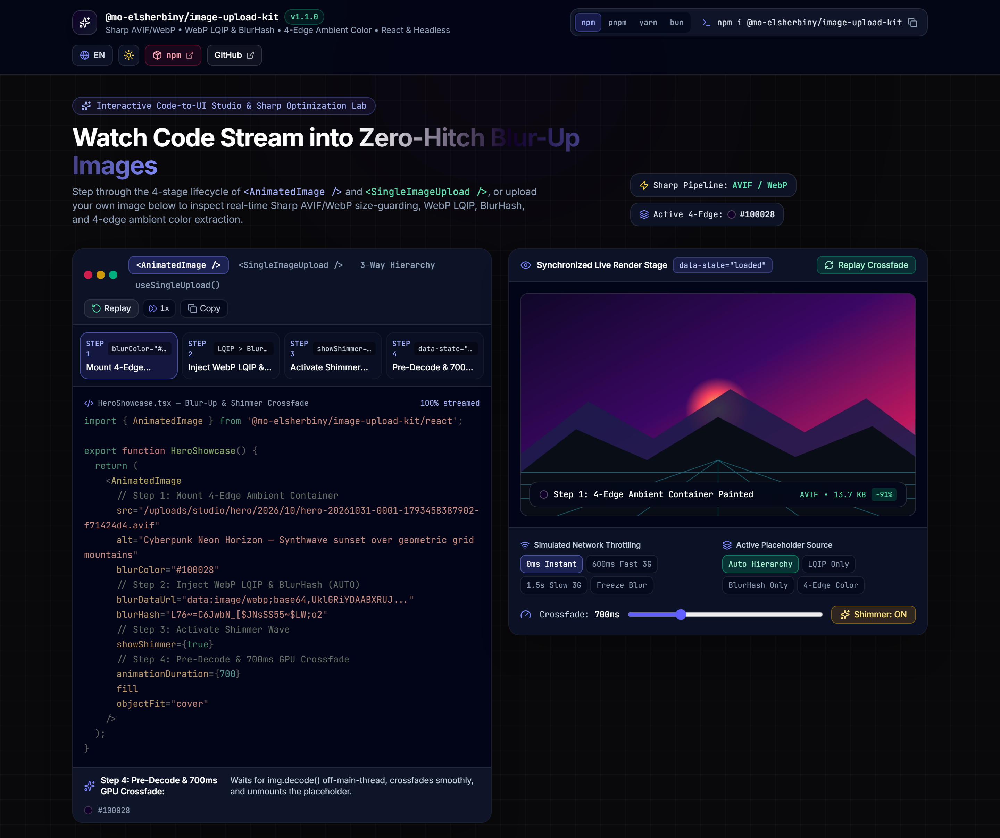
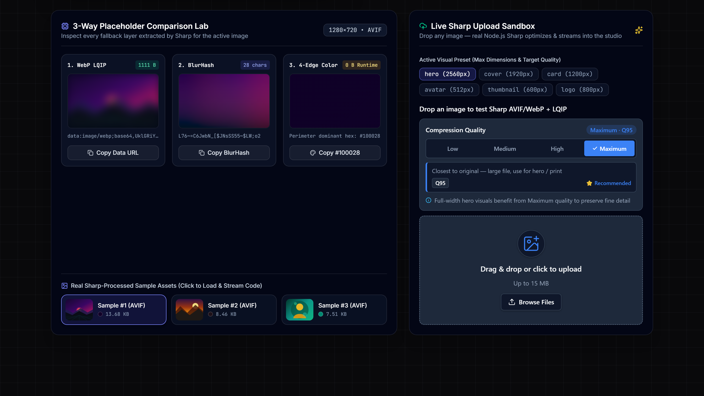

<div align="center">

# img-upload-kit

**Drop-in image uploads that arrive optimized.**
Upload, crop, compress to AVIF/WebP and show a blur-up placeholder in React, Vue, Angular and React Native, with one server route.

[](https://www.npmjs.com/package/img-upload-kit)
[](https://www.npmjs.com/package/img-upload-kit)
[](https://github.com/MoElsherbiny/image-upload-kit/actions/workflows/ci.yml)
[](https://www.npmjs.com/package/img-upload-kit)
[](https://github.com/MoElsherbiny/image-upload-kit/blob/main/package.json)
[](https://github.com/MoElsherbiny/image-upload-kit/blob/main/LICENSE)

[**Live demo**](https://upload-kit.buildwithsherbo.com) · [Quick start](#quick-start) · [Use cases](#use-cases) · [Docs](#documentation)



</div>

## Why img-upload-kit?

Most upload libraries stop at "the file reached the server". This one handles everything after that:

- 🖼️ **Optimized output**: Sharp resizes and re-encodes each upload (AVIF by default, keeping the original only when it's already smaller), with optional responsive `srcSet` variants.
- ✨ **Instant placeholders**: each upload returns a blur preview (LQIP), a BlurHash and a dominant color, so pages never show an empty box.
- ✂️ **Smart cropping**: ready-made `1:1`, `4:5` and `9:16` presets crop around the subject for product photos, feeds and stories.
- 🧩 **One API, every framework**: React/Next.js, Vue 3/Nuxt, Angular 17+, React Native/Expo, or headless hooks for your own UI.
- 🔒 **Secure by default**: file-type checks by magic bytes, SVG sanitizing, size limits, origin checks and an `authorize` hook.
- 🪶 **Zero runtime dependencies**: install only the framework you use; `sharp` is needed on the server only.

## Quick start

### 1. Install (Interactive CLI or Manual)

```bash
# Interactive terminal menu (choose React, Vue/Nuxt, Angular, React Native & storage with ↑/↓ arrows):
npx img-upload-kit@latest init

# Or install directly (sharp is needed on the Node.js 20+ server only):
npm i img-upload-kit sharp          # or: pnpm add / yarn add / bun add
```

### 2. Add an upload route

This example uses Next.js App Router and saves files to `public/uploads`. Any framework that speaks the Web `Request`/`Response` API works the same way (Nuxt, Remix, Hono, SvelteKit; Express [via a bridge](https://github.com/MoElsherbiny/image-upload-kit/blob/main/docs/FRAMEWORK_RECIPES.md)).

```ts
// app/api/upload/route.ts
import { createImageUploader, createUploadHttpHandler } from 'img-upload-kit/server';
import { createLocalFsStorageAdapter } from 'img-upload-kit/storage';

const uploader = createImageUploader({
  storage: createLocalFsStorageAdapter({ rootDir: './public/uploads', baseUrl: '/uploads' }),
});

export const { POST, DELETE } = createUploadHttpHandler({
  uploader,
  authorize: async ({ request }) => Boolean(request.headers.get('cookie')), // plug in your auth
});
```

### 3. Drop in the component

```tsx
'use client';
import { useState } from 'react';
import { SingleImageUpload, AnimatedImage } from 'img-upload-kit/react';
import type { UploadedImageData } from 'img-upload-kit';
import 'img-upload-kit/styles.css';

export function AvatarField() {
  const [avatar, setAvatar] = useState<UploadedImageData | null>(null);
  return (
    <>
      <SingleImageUpload endpoint="/api/upload" preset="avatar" value={avatar} onChange={setAvatar} />
      {avatar && <AnimatedImage image={avatar} alt="Avatar" width={128} height={128} />}
    </>
  );
}
```

That's it. Every upload returns an `UploadedImageData` you can store in your database:

```ts
{
  url: "/uploads/images/…/avatar.avif",
  width: 512, height: 512, format: "avif", size: 18342,
  blurDataUrl: "data:image/webp;base64,UklGR…", // tiny inline WebP placeholder
  blurColor: "#a3b1c2",                         // dominant 4-edge ambient color
  contentHash: "3f9c1a…"                        // SHA-256 content hash
}
```



## Use cases

| I want to… | Use | Guide |
| --- | --- | --- |
| Let users upload a profile picture | `<SingleImageUpload preset="avatar">` | [React](https://github.com/MoElsherbiny/image-upload-kit/blob/main/docs/CUSTOM_STYLING.md) · [Vue](https://github.com/MoElsherbiny/image-upload-kit/blob/main/docs/vue.md) |
| Build a product gallery with drag-to-reorder and a cover photo | `<MultiImageUpload mode="multiple" preset="square" reorderable showCoverBadge>` | [E-commerce & social](https://github.com/MoElsherbiny/image-upload-kit/blob/main/docs/ecommerce-social.md) |
| Crop for Instagram feed (`4:5`) or Stories/Reels (`9:16`) | `preset="portrait"` / `preset="story"` | [E-commerce & social](https://github.com/MoElsherbiny/image-upload-kit/blob/main/docs/ecommerce-social.md) |
| Show images with a smooth blur-up instead of layout jumps | `<AnimatedImage>` | [AnimatedImage](https://github.com/MoElsherbiny/image-upload-kit/blob/main/docs/ANIMATED_IMAGE.md) |
| Upload large files on Vercel/Lambda (body size limits) | `uploadMode="presigned"` (direct to S3/R2/Supabase) | [Presigned & dedupe](https://github.com/MoElsherbiny/image-upload-kit/blob/main/docs/presigned-and-dedupe.md) |
| Shrink photos in the browser before they upload | `createClientResizeTransform()` | [Presigned & dedupe](https://github.com/MoElsherbiny/image-upload-kit/blob/main/docs/presigned-and-dedupe.md) |
| Avoid storing the same image twice | `deduplicate: { store }` | [Presigned & dedupe](https://github.com/MoElsherbiny/image-upload-kit/blob/main/docs/presigned-and-dedupe.md) |
| Pick from camera or gallery on mobile | `img-upload-kit/react-native` + Expo picker | [React Native](https://github.com/MoElsherbiny/image-upload-kit/blob/main/docs/react-native.md) |
| Use my own design system | `unstyled`, slot `classNames`, or headless hooks | [Custom styling](https://github.com/MoElsherbiny/image-upload-kit/blob/main/docs/CUSTOM_STYLING.md) |
| Store files in S3, R2, Supabase or on disk | Storage adapters | [Recipes](https://github.com/MoElsherbiny/image-upload-kit/blob/main/docs/FRAMEWORK_RECIPES.md) |

## Framework examples

<details>
<summary><b>React: product gallery with reordering</b></summary>

```tsx
import { useState } from 'react';
import { ImageUploadProvider, MultiImageUpload } from 'img-upload-kit/react';
import { createClientResizeTransform } from 'img-upload-kit/client';
import type { UploadedImageData } from 'img-upload-kit';
import 'img-upload-kit/styles.css';

const resize = createClientResizeTransform({ maxWidth: 2048, maxHeight: 2048 });

export function ProductGallery() {
  const [images, setImages] = useState<UploadedImageData[]>([]);
  return (
    <ImageUploadProvider endpoint="/api/upload" deleteEndpoint="/api/upload">
      <MultiImageUpload
        mode="multiple" preset="square" maxImages={8} reorderable showCoverBadge
        value={images} onChange={setImages} transformAsset={resize}
      />
    </ImageUploadProvider>
  );
}
```
</details>

<details>
<summary><b>Vue 3 / Nuxt</b></summary>

```ts
// main.ts (or a Nuxt plugin)
import { createImageUpload } from 'img-upload-kit/vue';
import 'img-upload-kit/styles.css';
app.use(createImageUpload({ endpoint: '/api/upload' }));
```

```vue
<script setup lang="ts">
import { ref } from 'vue';
import type { UploadedImageData } from 'img-upload-kit';
import { SingleImageUpload, MultiImageUpload } from 'img-upload-kit/vue';
const avatar = ref<UploadedImageData | null>(null);
const gallery = ref<UploadedImageData[]>([]);
</script>

<template>
  <SingleImageUpload v-model="avatar" preset="avatar" />
  <MultiImageUpload v-model="gallery" preset="square" reorderable :max-images="8" />
</template>
```

Full guide: [docs/vue.md](https://github.com/MoElsherbiny/image-upload-kit/blob/main/docs/vue.md)
</details>

<details>
<summary><b>Angular 17+ (signals, zoneless-ready)</b></summary>

```ts
// app.config.ts
import { provideImageUploadConfig } from 'img-upload-kit/angular';
export const appConfig = { providers: [provideImageUploadConfig({ endpoint: '/api/upload' })] };
```

```ts
// cover-upload.component.ts
import { Component, DestroyRef, inject, signal } from '@angular/core';
import { createSingleUpload, resolveImageUploadConfig, withAngularSignals } from 'img-upload-kit/angular';

@Component({
  selector: 'app-cover-upload',
  standalone: true,
  template: `
    <input type="file" accept="image/*" (change)="pick($event)" />
    @if (upload.isUploading()) { <progress [value]="upload.progress()" max="100"></progress> }
    @if (upload.previewUrl(); as src) {  }
  `,
})
export class CoverUploadComponent {
  readonly upload = withAngularSignals(
    createSingleUpload({ ...resolveImageUploadConfig(), preset: 'cover' }),
    { signal, destroyRef: inject(DestroyRef) },
  );

  pick(event: Event) {
    const file = (event.target as HTMLInputElement).files?.[0];
    if (file) void this.upload.selectFile(file);
  }
}
```

Full guide: [docs/angular.md](https://github.com/MoElsherbiny/image-upload-kit/blob/main/docs/angular.md)
</details>

<details>
<summary><b>React Native / Expo</b></summary>

```tsx
import { useState } from 'react';
import * as ImagePicker from 'expo-image-picker';
import type { UploadedImageData } from 'img-upload-kit';
import { NativeImageUploadProvider, SingleImageUpload, createExpoImagePickerAdapter } from 'img-upload-kit/react-native';

const picker = createExpoImagePickerAdapter(ImagePicker, { quality: 0.9 });

export function ProfileScreen() {
  const [photo, setPhoto] = useState<UploadedImageData | null>(null);
  return (
    <NativeImageUploadProvider endpoint="https://api.example.com/api/upload" picker={picker}>
      <SingleImageUpload preset="portrait" value={photo} onChange={setPhoto} />
    </NativeImageUploadProvider>
  );
}
```

Full guide: [docs/react-native.md](https://github.com/MoElsherbiny/image-upload-kit/blob/main/docs/react-native.md)
</details>

<details>
<summary><b>Production storage: S3 / Cloudflare R2 / Supabase</b></summary>

Swap the local disk adapter for any storage backend. The SDK stays your own dependency, so `img-upload-kit` never pins a version.

```ts
import { S3Client, PutObjectCommand, DeleteObjectCommand, GetObjectCommand } from '@aws-sdk/client-s3';
import { createS3StorageAdapter } from 'img-upload-kit/storage';

const s3 = new S3Client({ region: 'auto', endpoint: process.env.S3_ENDPOINT });

const storage = createS3StorageAdapter({
  publicBaseUrl: 'https://cdn.example.com',
  defaultBucket: 'media',
  putObject: (input) => s3.send(new PutObjectCommand(input)),
  deleteObject: (input) => s3.send(new DeleteObjectCommand(input)),
  getObject: (input) => s3.send(new GetObjectCommand(input)),
});
```

Supabase, presigned uploads and database persistence: [docs/FRAMEWORK_RECIPES.md](https://github.com/MoElsherbiny/image-upload-kit/blob/main/docs/FRAMEWORK_RECIPES.md)
</details>

## Built-in presets

Pick a visual role and the kit applies sensible size, crop and quality limits. You can also [define your own](https://github.com/MoElsherbiny/image-upload-kit/blob/main/docs/ARCHITECTURE.md) with `defineUploadPresets`.

| Preset | Output | Crop | Best for |
| --- | --- | --- | --- |
| `avatar` | ≤ 512×512 | fit | Profile pictures |
| `thumbnail` | ≤ 600×600 | fit | Grid thumbnails |
| `card` | ≤ 1200×900 | fit | Article & content cards |
| `cover` | ≤ 1920×1080 | fit | Section banners |
| `hero` | ≤ 2560×1440 | fit | Full-width headers |
| `square` | ≤ 1600×1600 | `1:1` smart | Product photos, square posts |
| `portrait` | ≤ 1080×1350 | `4:5` smart | Instagram feed |
| `story` | ≤ 1080×1920 | `9:16` smart | Stories, Reels, mobile covers |
| `logo` | ≤ 800×800 | fit | Logos (`allowSvg: true` for sanitized SVG) |
| `original` | ≤ 4096×4096 | fit | Archival master copies |

## Package entry points

Import only what you need. Each entry point is tree-shakeable and ships ESM + CJS + types.

| Import | Runs on | What's inside |
| --- | --- | --- |
| `img-upload-kit/react` | Browser | Ready-made components and `<AnimatedImage>` |
| `img-upload-kit/headless` | Browser | Hooks and render props for fully custom UI |
| `img-upload-kit/vue` | Browser / SSR | Vue plugin, components, composables |
| `img-upload-kit/angular` | Browser | Signal controllers and DOM helpers |
| `img-upload-kit/react-native` | iOS / Android | Native components, hooks, Expo & RN picker adapters |
| `img-upload-kit/client` | Any JS runtime | Framework-agnostic upload engine, resize, presigned flow |
| `img-upload-kit/server` | Node.js 20+ | Uploader, Sharp optimizer, HTTP handler, dedupe |
| `img-upload-kit/server/handler` | Node / Edge | Edge-safe HTTP handler (no Sharp at import time) |
| `img-upload-kit/storage` | Node / Edge | S3/R2, Supabase, local disk and in-memory adapters |
| `img-upload-kit/blur` | Any | BlurHash decoding and placeholder helpers |
| `img-upload-kit/styles.css` | Browser | Default theme (`--iuk-*` tokens, dark mode, RTL) |

## Documentation

- **Frameworks & Guides:** [Vue & Nuxt](https://github.com/MoElsherbiny/image-upload-kit/blob/main/docs/vue.md) · [Angular](https://github.com/MoElsherbiny/image-upload-kit/blob/main/docs/angular.md) · [React Native & Expo](https://github.com/MoElsherbiny/image-upload-kit/blob/main/docs/react-native.md) · [E-commerce & social cropping](https://github.com/MoElsherbiny/image-upload-kit/blob/main/docs/ecommerce-social.md) · [Presigned uploads, resize & dedupe](https://github.com/MoElsherbiny/image-upload-kit/blob/main/docs/presigned-and-dedupe.md) · [AnimatedImage](https://github.com/MoElsherbiny/image-upload-kit/blob/main/docs/ANIMATED_IMAGE.md)
- **Customizing & Project:** [Styling & headless tiers](https://github.com/MoElsherbiny/image-upload-kit/blob/main/docs/CUSTOM_STYLING.md) · [Framework & storage recipes](https://github.com/MoElsherbiny/image-upload-kit/blob/main/docs/FRAMEWORK_RECIPES.md) · [Architecture](https://github.com/MoElsherbiny/image-upload-kit/blob/main/docs/ARCHITECTURE.md) · [Changelog](https://github.com/MoElsherbiny/image-upload-kit/blob/main/CHANGELOG.md) · [Migration from v1](https://github.com/MoElsherbiny/image-upload-kit/blob/main/MIGRATION.md) · [Roadmap](https://github.com/MoElsherbiny/image-upload-kit/blob/main/ROADMAP.md) · [Security policy](https://github.com/MoElsherbiny/image-upload-kit/blob/main/SECURITY.md)

## Contributing & License

Issues and pull requests are welcome — see [CONTRIBUTING.md](https://github.com/MoElsherbiny/image-upload-kit/blob/main/CONTRIBUTING.md) and [SECURITY.md](https://github.com/MoElsherbiny/image-upload-kit/blob/main/SECURITY.md).
[MIT](https://github.com/MoElsherbiny/image-upload-kit/blob/main/LICENSE) © [Mohamed Elsherbiny](https://www.buildwithsherbo.com/) · [@MoElsherbiny](https://github.com/MoElsherbiny)
