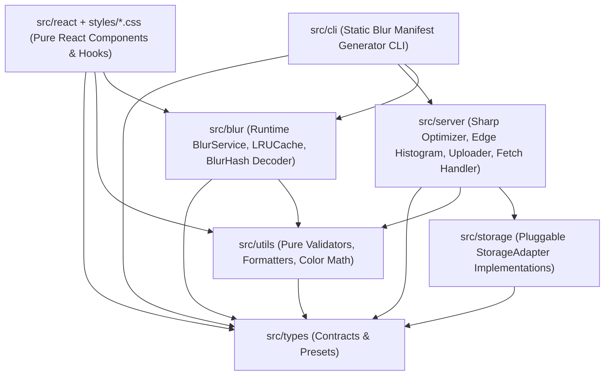

# Architecture & Internals

`img-upload-kit` is engineered as a modular, runtime-conscious TypeScript package where client bundles stay completely free of Node/Sharp dependencies and server pipelines remain independent of UI frameworks.

## 1. Module Dependency Graph



### Strict Layer Boundaries

- **Zero Upward Coupling**: `src/types` and `src/utils` have zero runtime dependencies.
- **Browser Safety**: `src/react` and `src/blur` never import `node:*` built-ins or `sharp`. `tsup` builds `dist/react.js` with a `'use client';` banner so React Server Component bundlers treat UI components as client boundaries automatically.
- **Framework Independence**: No `next/*`, `@supabase/supabase-js`, or `@aws-sdk/client-s3` packages are required at install time. Cloud adapters use structural TypeScript interfaces, and framework `<Image />` components plug in via `renderImage`.

---

## 2. Separation of Concerns Directory Layout

```text
src/
├── index.ts                 # Root barrel (types, pure utils, storage contracts, blur helpers)
├── types/                   # Preset contracts, quality presets, upload payloads
├── utils/                   # Pure color math, byte formatters, EN/AR file validators
├── storage/                 # StorageAdapter contract + LocalFS, Memory, Supabase, S3/R2
├── blur/                    # BlurService, bounded LRUCache, path mapper, SVG fallbacks
├── server/                  # Sharp AVIF/WebP optimizer, 4-edge color extractor,
│                            # AsyncSemaphore, createImageUploader, Fetch HTTP handler
├── react/
│   ├── context.tsx          # <ImageUploadProvider /> & configuration context
│   ├── i18n.ts              # Bilingual English & Arabic (RTL) dictionaries
│   ├── hooks/               # Upload XHR/uploader state & drag-and-drop hooks
│   ├── components/          # Single/Multi upload UI, modals, AnimatedImage, BlurImage
│   ├── headless/            # Headless hooks & render-prop controllers
│   └── styles/              # 6 layered CSS files bundled into dist/styles.css
└── cli/                     # Commander CLI (generate, validate, sync, cleanup, health, inspect)
```

---

## 3. The Strict `<= 300` Lines-Per-File Budget

Every file in the repository — source code, React components, CSS layers, tests, scripts, configs, and Markdown documentation — is strictly capped at **300 lines** (targeting 60–240 lines per file).

Why enforce a hard ceiling?

1. **Predictable Cognitive Load**: Every module has a single, immediately scannable responsibility (e.g., `semaphore.ts` only coordinates concurrency and timeouts; `s3Adapter.ts` only adapts S3 object operations).
2. **Tree-Shakeable Granularity**: Small focused modules allow bundlers (`tsup` / Rollup / Webpack / Vite) to eliminate unused code paths cleanly.
3. **Dual Enforcement**:
   - **ESLint Flat Config (`eslint.config.mjs`)**: Enforces `"max-lines": ["error", { "max": 300, "skipBlankLines": false, "skipComments": false }]`.
   - **Repository Scanner (`scripts/check-max-lines.mjs`)**: Runs via `npm run check:lines` in CI and `prepublishOnly`, auditing TypeScript, CSS, YAML, JSON, and Markdown files alike.

---

## 4. Universal Preset System & `UploadKitRegister`

Hardcoding domain-specific categories (such as `homepage` or `brochure`) inside an npm library forces consumers into awkward workarounds. Instead, `img-upload-kit` separates **visual roles** from **domain entities**:

1. **Built-In Visual Roles (`STANDARD_PRESETS`)**:
   - `thumbnail` (`600x600`, Q78, raster-only)
   - `avatar` (`512x512`, Q80, raster-only)
   - `card` (`1200x900`, Q85)
   - `cover` (`1920x1080`, Q88)
   - `hero` (`2560x1440`, Q92)
   - `logo` (`800x800`, Q90, SVG-friendly)
   - `original` (`4096x4096`, Q95)
2. **Project Presets (`defineUploadPresets`)**:
   Consumers define custom presets with bucket, folder, dimensions, allowed MIME formats, quality, and `includeBlurHash`, then pass them to `createImageUploader({ presets })`. Resolution follows a deterministic cascade:
   `per-call ImageUploadOptions` -> `named UploadPresetConfig` -> `ImageUploaderOptions defaults`.
3. **Compile-Time Augmentation (`UploadKitRegister`)**:
   By augmenting `UploadKitRegister` in a project `.d.ts` file, `UploadPresetName` narrows globally across `<SingleImageUpload preset="..." />`, `<MultiImageUpload preset="..." />`, and server helpers:

   ```ts
   declare module 'img-upload-kit' {
     interface UploadKitRegister {
       presets: 'product-hero' | 'product-thumb' | 'author-avatar';
     }
   }
   ```

---

## 5. Sharp AVIF Size-Guard Pipeline

Naive image pipelines unconditionally re-encode every upload to AVIF at a fixed quality (e.g., Q85). When a user uploads an already heavily compressed JPEG (e.g., Q60), re-encoding at Q85 AVIF can **increase** byte size by 30–80%.

`optimizeImage` prevents file bloat with a multi-stage size-guard:

1. **SVG Passthrough**: Vector SVGs bypass rasterization entirely while extracting `width`/`height` from metadata or `viewBox`.
2. **Bounded Lanczos3 Resize**: Raster images resize with `fit: 'inside'` and `withoutEnlargement: true` so small assets are never upscaled.
3. **Primary AVIF Pass**: Encodes 8-bit `4:2:0` AVIF (`effort: 6`) at `baseQuality` (default `85` for photos, `88` for graphics). If `avifSize <= originalSize` (or `outputFormat: 'avif'` was explicitly requested), it returns immediately.
4. **Proportional Quality Retry**: If the primary AVIF exceeds `originalSize`, quality is scaled down proportionally (`Math.max(40, Math.round(baseQuality * Math.sqrt(originalSize / avifSize)))`) and retried at `effort: 5`.
5. **Passthrough or WebP Shootout**:
   - If the retry still exceeds `originalSize` **and** the source image did not exceed `maxDimensions`, the original buffer passes through untouched (`size === originalSize`).
   - If dimensions **were** capped, a smart-subsampled WebP candidate (`effort: 6`) is encoded and the smaller buffer (`webp` vs `avif`) wins.

---

## 6. 4-Edge Color Histogram & Progressive LQIP

Center-weighted dominant color extractors often pick a bright subject color from the middle of a photo while the image's outer borders are dark or neutral — causing a harsh visual seam around `object-fit: contain` containers or rounded cards during progressive blur-up.

`generateBlurPlaceholder` pairs a compact **WebP LQIP** (`128px` wide, auto-stepping down to `96px` if base64 length exceeds `8,000` chars) with a **4-edge color histogram**:

1. **Perimeter Band Sampling**: The image is downsampled to `<= 400x400` raw RGBA, and four perimeter bands (`top`, `right`, `bottom`, `left`, each `12%` thick) are sampled.
2. **Distance-Weighted Quantization**: Pixels closer to the outer border receive higher linear weights (`1.0` to `2.0`). Near-transparent (`alpha < 8`) and near-black shadow noise (`brightness < 12`) pixels are ignored, while RGB values quantize into `16`-unit histogram buckets.
3. **White-Background Guard**: Near-white pixels (`R,G,B >= 245`) accumulate separately and only win an edge (`#F9FAFB`) when white strength exceeds chromatic weight by `1.35x` (`WHITE_DOMINANCE_RATIO`), preventing studio product cutouts from washing out subtle border tones while still honoring true white backgrounds.
4. **4-Edge Blend**: The winning hex colors from `top`, `right`, `bottom`, and `left` are averaged in RGB space to produce `blurColor`, yielding an organic ambient backdrop behind `<BlurImage />`.
