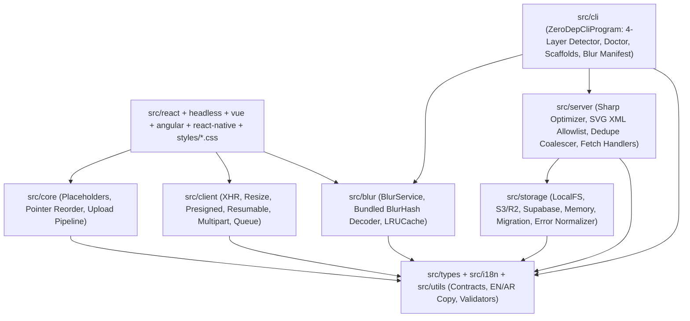

# Architecture & Internals

`img-upload-kit` (v2.3) is engineered as a zero-dependency, multi-platform TypeScript package where browser and React Native bundles stay completely free of Node/Sharp modules, server handlers run cleanly across Node.js 20+ and Edge isolates, and every file remains `<= 300` lines.

## 1. Module Dependency Graph



### Strict Layer Boundaries

- **Zero Runtime Dependencies**: `package.json` `"dependencies"` is `{}`. `blurhash` is bundled into `dist/`, while `sharp` and UI frameworks (`react`, `vue`, `@angular/core`, `react-native`) are optional peer dependencies.
- **Browser, SSR & Native Safety**: Client and UI entrypoints never import `node:*` built-ins or `sharp`. `dist/react.js` and `dist/headless.js` emit `'use client';` banners for React Server Components; `img-upload-kit/server/handler` avoids top-level Sharp imports for Edge runtimes; `img-upload-kit/react-native` never touches DOM globals (`window`, `document`, `HTMLImageElement`).
- **Zero Vendor Lock-In**: Cloud storage adapters use structural TypeScript contracts (`createS3StorageAdapter`, `createSupabaseStorageAdapter`, `createStorageAdapter`) so your application owns its SDK versions.

---

## 2. Directory Layout

```text
src/
├── index.ts          # Root '.' — Types, presets, aspectRatio, UploadKitError, validators, blur helpers
├── types/            # aspectRatio, errors (UploadKitError), rateLimit, quality, presets, upload
├── core/             # Shared placeholders, attachPointerReorder, framework-agnostic uploadPipeline
├── i18n/             # Bilingual English (en) & Arabic (ar) dictionaries + pluralization
├── utils/            # Pure 4-edge color math, byte/path formatters, strict file validators
├── client/           # './client' — XHR, resize, presigned, resumable, multipart, retry, queue, reorder
├── storage/          # './storage' — S3/R2, Supabase, LocalFS, Memory, migrateStorage, errorNormalizer
├── blur/             # './blur' — BlurService, bundled BlurHash decoder, pathMapper, LRUCache
├── server/           # './server' & './server/handler'
│   ├── semaphore.ts  # Bounded Sharp concurrency & AbortSignal queue coordination
│   ├── security/     # sniffFormat, XML tokenizer/allowlist sanitizeSvg, assertImageMetadataLimits
│   ├── optimization/ # optimizeImage, resizePlan (focalPoint), formatNegotiator, transformCache, LQIP
│   ├── uploader/     # createImageUploader, dedupe, inFlightCoalescer, variantGenerator, uploadRetry
│   └── handler/      # Direct, presign/finalize, resumable, multipart, delete, uploadToken, rateLimitGuard
├── cli/              # './cli' & 'dist/bin.js' — ZeroDepCliProgram, 4-layer detection, doctor, scaffolds
├── react/            # './react' & './headless' — Components, hooks, slot styling, 6 modular CSS layers
├── vue/              # './vue' — Vue 3.5+ / Nuxt 4 plugin, composables, v-model & headless components
├── angular/          # './angular' — Angular 17–21+ controllers, withAngularSignals, CVA & DOM mounters
└── react-native/     # './react-native' — Native provider, Expo/RN pickers, hooks, components & themes
```

---

## 3. Strict `<= 300` Lines-Per-File Guardrail

Every file in the repository — TypeScript source, UI components, CSS stylesheets, tests, scripts, and Markdown docs — is capped at **300 lines**:

1. **ESLint Flat Config (`eslint.config.mjs`)**: Enforces `"max-lines": ["error", { "max": 300, "skipBlankLines": false, "skipComments": false }]` alongside `@typescript-eslint/no-explicit-any: "error"`.
2. **Repository Scanner (`scripts/check-max-lines.mjs`)**: Verifies every `.ts`, `.tsx`, `.js`, `.mjs`, `.cjs`, `.css`, and `.md` file in CI and `prepublishOnly`.

---

## 4. Universal Presets, Focal Cropping, Negotiation & Transform Caching

`STANDARD_PRESETS` defines **10 universal visual roles** without domain-specific coupling:

- **Fit-Inside Roles**: `thumbnail` (`600x600`, Q78), `avatar` (`512x512`, Q80), `card` (`1200x900`, Q85), `cover` (`1920x1080`, Q88), `hero` (`2560x1440`, Q92), `logo` (`800x800`, Q90, opt-in `allowSvg`), and `original` (`4096x4096`, Q95).
- **Smart Aspect-Cropped Roles**: `square` (`1600x1600`, `1:1`, variants `[400, 800, 1200]`), `portrait` (`1080x1350`, `4:5`, variants `[480, 720]`), and `story` (`1080x1920`, `9:16`, variants `[540, 720]`), each defaulting to Sharp `crop: 'attention'`.

Fine-grained server optimization controls include:

- **Focal-Point Cropping (`focalPoint: { x, y }`)**: Normalized `[0, 1]` coordinates compute an exact region extraction (`buildResizePlan`) overriding heuristic `crop` positioning when subject coordinates are known.
- **Color Space & Format Negotiation**: `colorSpace: 'srgb' | 'preserve'` normalizes wide-gamut Display-P3/CMYK uploads when `'srgb'` is chosen, and `negotiateOutputFormat(acceptHeader, options)` selects the optimal `avif`/`webp`/`jpeg`/`png` format from HTTP `Accept` quality weights.
- **Transform Caching (`TransformCache`)**: `createMemoryTransformCache({ maxEntries, maxBytes, ttlMs })` and `buildTransformCacheKey` memoize `OptimizedImageResult` outputs across identical content hashes and transform parameters.
- **Compile-Time Preset Augmentation (`UploadKitRegister`)**:

```ts
declare module 'img-upload-kit' {
  interface UploadKitRegister {
    presets: 'product-hero' | 'product-thumb' | 'author-avatar';
  }
}
```

---

## 5. Sharp AVIF Size-Guard & Privacy-Safe Metadata Stripping

Re-encoding an already compact Q60 JPEG into Q85 AVIF can inflate file size by 30–80%. `optimizeImage` prevents size regressions while guaranteeing EXIF privacy by default:

1. **Pre-Sharp SVG Gate**: SVGs are sniffed and sanitized through the zero-dependency XML tokenizer + allowlist (`sanitizeSvg`) *before* touching libvips, enforcing `assertImageMetadataLimits`.
2. **EXIF Auto-Orient & Metadata Stripping**: Raster inputs run `.rotate()` to apply EXIF orientation and **strip EXIF/GPS/XMP/IPTC metadata by default** unless `preserveMetadata: true` is explicitly passed.
3. **Primary & Scaled AVIF Passes**: Encodes 8-bit `4:2:0` AVIF (`effort: 6`, configurable via `effort`). If `avifSize > originalSize` (and `outputFormat: 'avif'` was not forced), quality scales proportionally (`Math.max(40, Math.round(baseQuality * Math.sqrt(originalSize / avifSize)))`) for a retry pass.
4. **Privacy-Safe Passthrough or WebP Shootout**:
   - When dimensions were not capped and no aspect crop is needed, `optimizeImage` re-encodes in the source format (`mozjpeg` / `png` / `webp` / `avif`) so stripped metadata stays stripped. For un-rotated JPEGs where re-encoding still exceeds `originalSize`, the raw buffer passes through untouched **only** when `preserveMetadata: true` or when no EXIF, XMP, IPTC, or comment metadata is present; otherwise `mozjpeg` re-encodes to guarantee GPS/camera metadata removal.
   - When dimensions or aspect ratios *were* modified, a smart-subsampled WebP candidate competes head-to-head against the scaled AVIF and the smaller buffer wins.

---

## 6. 4-Edge Ambient Color Histogram & Progressive LQIP

`generateBlurPlaceholder` pairs a compact **WebP LQIP** (`128px` wide, stepping down to `96px` if base64 exceeds `8,000` chars) and optional BlurHash with a **4-edge perimeter histogram**:

1. Samples four `12%` perimeter bands (`top`, `right`, `bottom`, `left`) at `<= 400x400` RGBA with linear border-proximity weights (`1.0` to `2.0`), ignoring transparent (`alpha < 8`) and shadow-noise (`brightness < 12`) pixels.
2. Guards studio cutouts via `WHITE_DOMINANCE_RATIO` (`1.35x`) so near-white backgrounds (`#F9FAFB`) win only when genuinely dominant, then blends the 4 winning edge colors in RGB space into `blurColor`.

---

## 7. Canonical Testing Pyramid

Verification spans seven structured tiers under `tests/` (`*.dom.test.{ts,tsx}` runs in `jsdom`; all other suites run in `node`):

`unit` (`core`, `client`, `storage`, `server`) -> `frameworks` (`react`, `headless`, `vue`, `angular`, `react-native`) -> `cli` (detection, scaffolds, `doctor`, manifest) -> `security` (adversarial SVG, tokens, limits, rate limiting) -> `integration` (framework parity, Node servers, presigned, resumable, multipart) -> `e2e` (live `node:http` + Sharp + disk across all UI frameworks & CLI lifecycles) -> `packaging` (`dist/` invariants, `npm pack`, and isolated `tsc` compilation of every `README.md` & `docs/*.md` TypeScript block).
